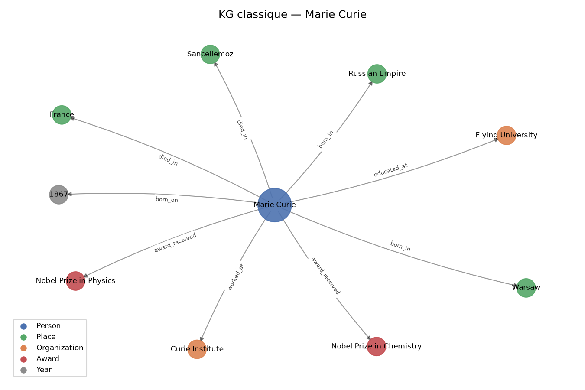
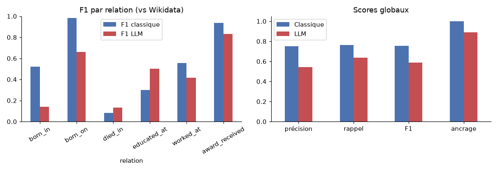

# Knowledge Extraction from Unstructured Text — Knowledge Graph des lauréats du prix Nobel de physique

Master 2 Informatique — Projet Knowledge Extraction — 2026 · Code, données et notebook : dépôt GitHub du projet (<code>notebooks/knowledge_extraction.ipynb</code>)

## 1. Objectif et données

L'objectif est d'extraire des connaissances structurées (entités, relations, faits) à partir de textes bruts, de
construire un *Knowledge Graph* (KG), puis de comparer une chaîne de traitement classique (règles + apprentissage
automatique) avec un LLM. Toute l'expérience tourne sur un ordinateur portable sans GPU (CPU 8 cœurs, 8 Go de RAM).

| Jeu de données | Contenu | Rôle |
|---|---|---|
| **Wikipedia** (option 1 du sujet) | Introductions de 150 articles de lauréats du Nobel de physique (21 542 mots, 6 phrases et 165 tokens en moyenne), échantillon aléatoire fixe des 230 lauréats | Corpus principal du KG |
| **Wikidata** | 3 146 faits sur ces 150 personnes (lieu et date de naissance, lieu de décès, universités, employeurs, prix) | Référence pour évaluer les relations |
| **CoNLL-2003** (anglais) | Dépêches Reuters annotées PER / ORG / LOC / MISC : 14 041 phrases d'entraînement, 3 453 de test | Entraîner et évaluer la NER |

Ce corpus a deux avantages : des textes courts au style homogène, et des faits vérifiables automatiquement avec
Wikidata, ce qui évite d'annoter les relations à la main.

## 2. Méthodologie

**A — Prétraitement et représentation.** Nous utilisons deux niveaux de nettoyage. Le nettoyage *léger*
(normalisation Unicode, suppression des transcriptions phonétiques, des noms en écriture native et des renvois)
garde la casse et la ponctuation, indispensables à la NER et au parsing. La normalisation *forte* (lemmes spaCy en
minuscules, sans mots vides ni ponctuation) sert uniquement aux représentations vectorielles. La tokenisation, le POS
tagging et la lemmatisation sont faits avec NLTK (Penn Treebank + WordNet) et spaCy (`en_core_web_sm`) pour
comparaison. Deux représentations : **TF-IDF** (uni- et bigrammes, 2 000 termes) et des **embeddings Transformer**
`all-MiniLM-L6-v2` (BERT distillé, 384 dimensions, mean pooling). Elles sont exploitées sans supervision par K-Means
(k choisi par le score silhouette) et par recherche de voisins (similarité cosinus).

**B — Reconnaissance d'entités.** Trois approches, évaluées au niveau entité (frontières et type exacts, `seqeval`)
sur le test CoNLL :
(1) **règles** : `EntityRuler` de spaCy avec un dictionnaire de 8 028 entités vues dans le train et des motifs
(titre + nom propre → PER, mots capitalisés + *University/Party/Inc* → ORG, adjectifs de nationalité → MISC) ;
(2) **spaCy `en_core_web_sm`** pré-entraîné (OntoNotes, 18 types), avec projection vers les 4 types CoNLL ;
(3) **CRF** (`sklearn-crfsuite`, L-BFGS, c1 = 0,1, c2 = 0,05) entraîné sur le train CoNLL avec des traits classiques
(forme du mot, préfixes/suffixes, POS, fenêtre de ±2 mots). Sur le corpus Wikipedia, sans annotations, nous
classons les entités avec spaCy (PERSON, ORG, GPE, DATE, WORK_OF_ART…) et mesurons l'accord CRF/spaCy.

**C — Relations et Knowledge Graph.** Schéma de 6 relations vérifiables : `born_in`, `born_on`, `died_in`,
`educated_at`, `worked_at`, `award_received` (plus `shared_prize_with`, non évaluée). L'extraction repose sur
**l'analyse en dépendances** : pour chaque entité, on remonte ses ancêtres syntaxiques jusqu'au premier *mot
déclencheur* (`bear` → naissance, `educate/study/graduate` → études, `professor/work/join` → emploi,
`win/receive/award` → prix). Le sujet est le `nsubj` du verbe. Les pronoms *he/she/who* et le nom de famille
sont rattachés à la personne de l'article (coréférence heuristique). Le type de l'entité doit être compatible avec la
relation, et une règle distingue « *received his PhD from* » (études) de « *received the Prize* ». Les triplets
forment un `MultiDiGraph` NetworkX : nœuds typés (Person, Organization, Place, Award, Year), arcs étiquetés avec la
phrase source comme provenance. Exports : RDF/Turtle (rdflib), GraphML (Gephi, Neo4j), CSV et HTML interactif (pyvis).

**Évaluation des relations.** La *précision* est la part des triplets dont l'objet correspond (libellé ou alias,
correspondance approchée) à un fait Wikidata de la personne : c'est une borne inférieure, car Wikidata est incomplet.
Le *rappel* est calculé seulement sur les faits Wikidata dont l'objet est écrit dans le texte, pour ne pas exiger
d'informations absentes.

**D — LLM.** Nous utilisons **Qwen2.5-1.5B-Instruct**, exécuté localement sur CPU (Hugging Face Transformers,
bfloat16, ~3 Go de RAM, décodage glouton), sans clé API ni entraînement. Un prompt *few-shot* (un exemple) impose une
sortie JSON avec le même schéma de relations. Le même LLM fait aussi la NER sur 100 phrases tirées du test CoNLL.
Les réponses sont mises en cache pour rendre le notebook reproductible sans relancer 72 minutes de calcul. Le module
accepte aussi une API compatible OpenAI (Groq gratuit, Ollama) pour tester un modèle plus gros.

## 3. Résultats et visualisations

**Partie A.** Le prétraitement spaCy des 150 textes prend 2,4 s et les embeddings MiniLM 10,5 s. Les scores
silhouette restent faibles (max 0,020 pour TF-IDF, 0,064 pour MiniLM avec k = 6), car toutes les biographies se
ressemblent. Les clusters MiniLM restent interprétables : physique théorique, physique nucléaire et projet Manhattan,
lasers et physiciens allemands, semi-conducteurs (Nakamura, Akasaki, Amano). Les plus proches voisins d'Einstein
(Lenard, Wigner, Heisenberg, Wien, Planck) sont cohérents. NLTK et spaCy tokenisent de la même façon, mais WordNet
lemmatise mal les noms propres (*Hans* → *han*).

**Partie B — NER (test CoNLL-2003, 3 453 phrases).**

| Modèle | Précision | Rappel | F1 | F1 PER | F1 ORG | F1 LOC | F1 MISC |
|---|---|---|---|---|---|---|---|
| Règles (EntityRuler) | 0,751 | 0,518 | 0,613 | 0,257 | 0,650 | 0,763 | 0,705 |
| spaCy `en_core_web_sm` | 0,656 | 0,545 | 0,595 | 0,646 | 0,360 | 0,749 | 0,614 |
| **CRF** | **0,821** | **0,808** | **0,814** | **0,865** | **0,739** | **0,854** | **0,773** |

Sur le corpus Wikipedia, spaCy trouve 2 919 mentions (ORG 682, PERSON 660, DATE 650, NORP 246, WORK_OF_ART 214,
GPE 200…). L'accord CRF/spaCy sur les types communs n'est que de F1 = 0,46 : le CRF entraîné sur Reuters se transfère
mal à Wikipedia.

**Partie C — Relations et KG.** L'extraction produit 699 triplets en 0,3 s (après le parsing). Par rapport à Wikidata :

| | born_in | born_on | died_in | educated_at | worked_at | award_received | **Total** |
|---|---|---|---|---|---|---|---|
| Précision | 0,55 | 1,00 | 0,50 | 0,61 | 0,46 | 0,94 | **0,753** |
| Rappel | 0,50 | 0,97 | 0,05 | 0,20 | 0,71 | 0,93 | **0,762** |

Le KG compte **492 nœuds** (197 personnes, 173 organisations, 32 prix, 13 lieux, 77 années) et **699 arcs**, avec
une composante connexe géante de 484 nœuds (1 682 triplets RDF). Les organisations les plus partagées sont le *Manhattan
Project* (8 lauréats), *University of Cambridge* (7) et *University of California* (6).

{: style="width:52%"}

Figure 1 — Extrait du KG classique : ego-graphe de Marie Curie (la version interactive complète est dans <code>outputs/kg/</code>).

**Partie D — LLM vs approche classique (150 biographies).**

| Critère | Classique (spaCy + dépendances) | LLM (Qwen2.5-1.5B, CPU) |
|---|---|---|
| Triplets / nœuds | 699 / 492 | 829 / 585 |
| Précision / rappel / F1 vs Wikidata | **0,753 / 0,762 / 0,757** | 0,544 / 0,636 / 0,586 |
| Ancrage (objet présent dans le texte) | 1,00 | 0,89 |
| Conformité de la sortie | 100 % (par construction) | JSON valide 146/150, 9 valeurs « Not mentioned » |
| Temps total | 2,5 s | 4 316 s (≈ 29 s par texte) |
| Explicabilité | phrase source + mot déclencheur | aucune |
| NER sur 100 phrases CoNLL (F1) | CRF 0,828 · spaCy 0,659 · règles 0,635 | 0,250 (P 0,356, R 0,193) |

Les deux KG partagent 411 triplets (Jaccard = 0,37).

{: style="width:88%"}

Figure 2 — F1 par relation et scores globaux (référence Wikidata).

**Applications.** Une fonction de question-réponse traduit des questions en requêtes sur le graphe. Par exemple,
« *Who worked at Bell Labs?* » → Arthur Ashkin, John Bardeen, avec la phrase source de chaque arc. Une recommandation
par similarité de Jaccard sur les voisins propose des profils proches : pour Fermi, Wigner et Rabi (*Manhattan Project*,
*Atomic Energy Commission*).

## 4. Analyse critique

**Difficultés de l'extraction.** (i) *Coréférence* : la plupart des faits sont exprimés avec *He/She* ; sans
l'heuristique, on perd la majorité des relations, et elle ne marcherait pas sur des textes à plusieurs personnages.
(ii) *Propagation des erreurs* dans le pipeline : *Antony Hewish* étiqueté ORG, *the Matteucci Medal* étiqueté LAW,
*CERN* étiqueté GPE. Une erreur de NER casse la relation en aval, d'où les règles de rattrapage (« Prize », « Medal »,
« University »). (iii) *Normalisation et liage* : *University of California* et *University of California, Berkeley*
restent deux nœuds ; il faudrait un liage d'entités vers Wikidata. (iv) *Évaluation* : sans annotations de relations,
Wikidata sert de référence. Il est incomplet : *Bardeen – Bell Labs* et *Einstein – Swiss Patent Office* sont comptés
faux. Il est aussi plus précis que le texte : Wikidata donne une ville quand le texte donne un pays, ce qui explique
le faible score de `born_in`. Les intros mentionnent rarement le lieu de décès, d'où le rappel de 0,05 pour `died_in`.

**Règles vs apprentissage automatique.** Les règles sont rapides, explicables et précises sur ce qu'elles couvrent
(précision NER 0,75), sans données annotées. Mais elles ne généralisent pas : F1 PER = 0,26, car un nom absent du
dictionnaire est raté. Le CRF généralise grâce aux traits de forme et de contexte (F1 0,81) mais demande des données
annotées du même domaine et se dégrade hors domaine (accord 0,46 sur Wikipedia). spaCy, entraîné sur un autre
schéma, est pénalisé par la projection des types (ORG 0,36). Pour les relations, nous avons préféré les règles sur
dépendances, faute de données annotées. Le fine-tuning de BERT pour la RE (optionnel) demanderait d'annoter des
phrases ou d'utiliser Wikidata en *distant supervision*.

**Ambiguïté et polysémie.** Exemples observés : *Fermi* étiqueté lieu (GPE) 14 fois, *Lawrence*
à la fois personne et laboratoire, *Curie* et *Bohr* personnes ou instituts, *Columbia* université ou pays,
*received* (un prix ou un diplôme), *Physics World* (magazine) pris pour un employeur, *Manhattan Project* (projet
plutôt qu'employeur). Le LLM confond « nommé d'après » et « reçu par » : pour Fermi, il liste *Enrico Fermi Award*
et *Fermilab* parmi ses prix.

**Comparaison avec le LLM.** Le LLM n'a besoin d'aucune règle et son schéma se modifie par simple prompt. Il gère
mieux les formulations variées : rappel de `educated_at` de 0,72 contre 0,20 pour nos règles. Mais il est moins
précis sur presque toutes les relations et 11 % de ses objets ne figurent pas dans le texte. Une partie de ces cas
sont des inférences correctes (*German-born* → *Germany*), d'autres des inventions. Il est aussi environ 1 700 fois
plus lent sur CPU, et sa sortie doit être validée (JSON, valeurs « Not mentioned »). En NER sur CoNLL, le petit modèle
est très en dessous du CRF (F1 0,25) : il ignore les conventions d'annotation (pays classés MISC, personnes oubliées
dans les tableaux sportifs). Ces conclusions valent pour un modèle de 1,5 milliard de paramètres ; un modèle plus gros
(via Groq ou Ollama, prévu dans le code) ferait sûrement mieux, mais nous ne l'avons pas mesuré.

**Utilisation réelle.** Question-réponse avec justification, recommandation de profils ou d'institutions, recherche à
facettes (« lauréats passés par Cambridge »), et enrichissement de Wikidata : les triplets précis absents de Wikidata
sont des candidats à ajouter après validation humaine.

## 5. Conclusion et limites

La chaîne classique produit en quelques secondes un KG précis (F1 0,76) et traçable. Le CRF confirme l'intérêt de
l'apprentissage supervisé pour la NER quand des annotations du domaine existent. Le petit LLM local construit un KG
plus grand sans écrire de règles, mais il est moins fiable et beaucoup plus coûteux. Une solution réaliste combine les
deux : le LLM propose des triplets, puis des vérifications automatiques (ancrage dans le texte, types, Wikidata) les
filtrent. Limites : coréférence heuristique, pas de liage d'entités, évaluation par une référence externe imparfaite,
un seul LLM de petite taille testé.

Outils : Python 3.12, NLTK 3.10, spaCy 3.8, scikit-learn 1.9, sklearn-crfsuite 0.5, seqeval, Transformers 5.22, PyTorch 2.15 (CPU), NetworkX 3.7, rdflib 7.6, pyvis. Données : Wikipedia (CC BY-SA), Wikidata (CC0), CoNLL-2003 (Tjong Kim Sang &amp; De Meulder, 2003).

